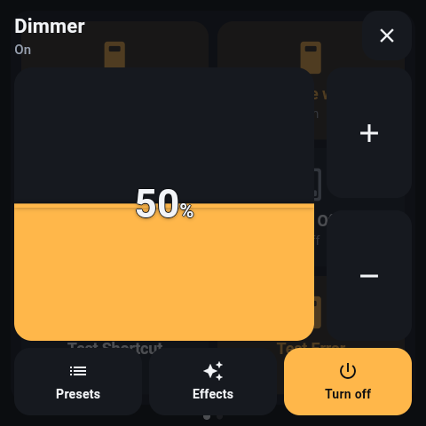
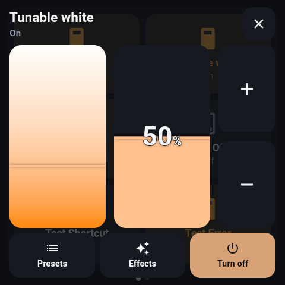
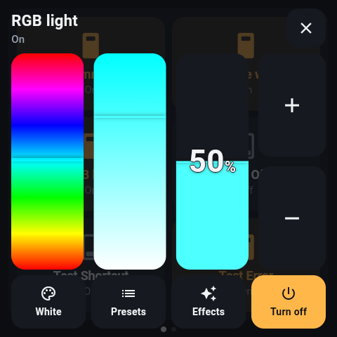
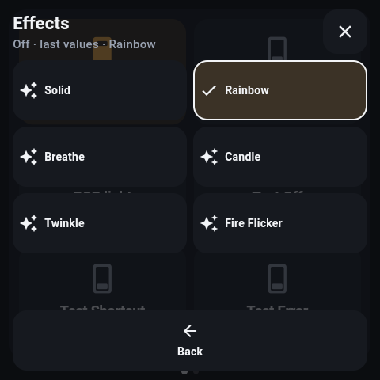
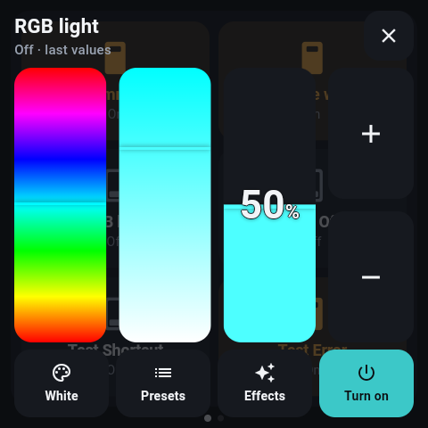

# NSPanel app

[](https://bunq.me/mennovanhout)

Home Assistant on the Sonoff NSPanel Pro 86, natively.

A Flutter app that renders the `custom:nspanel-*` cards from
[NSPanel-cards](https://github.com/mennovanhout/NSPanel-cards) without a browser in the way.
The web cards are careful with the panel's frame budget, but they are passengers: open a
dashboard in the companion app and the WebView is also running the whole HA frontend, and on a
PX30 that is most of the cost. This draws straight to the GPU instead.

**New here?** [TUTORIAL.md](TUTORIAL.md) walks from an empty Home Assistant to a working
panel, and has the short recipe for adding the second, third and fourth one.

## One config, two renderers

The app **reads your Lovelace dashboard from Home Assistant** over the websocket and renders
the `nspanel-*` cards in it. You keep configuring in HA - YAML or the GUI editor, which keeps
working - and the panel follows; edit the dashboard and it reloads on its own. The same
config still works in a browser with the web cards, on a phone or a tablet.

The layout it expects is the one the cards' README recommends: a panel view holding a swipe
card whose children are the pages - `custom:nspanel-swipe-card` from the cards bundle, or
`custom:simple-swipe-card` if you already have it; the app treats either the same and honours
`dots: false` (or `show_pagination: false`) and `start`. A view with no swipe card becomes one page. Cards it does
not know are shown as a marked gap rather than dropped, so you can see what a dashboard is
asking for that this app cannot do.

```yaml
views:
  - type: panel
    cards:
      - type: custom:nspanel-swipe-card
        cards:
          - type: vertical-stack
            cards:
              - type: custom:nspanel-light-card
                entity: light.dining_lights
                title: Dining table
                height: 260
              - type: custom:nspanel-light-card
                entity: light.lounge_lamp
                title: Lounge lamp
                height: 184
                show_presets: false
          - type: vertical-stack
            cards:
              - type: custom:nspanel-climate-card
                entity: climate.living_room
                height: 300
              - type: custom:nspanel-sensors-card
                height: 144
                entities: [sensor.outside_temp, sensor.outside_hum, sensor.wind]
```

Every card and option is documented in the cards repo's README; this app takes the same ones.
Heights are in logical pixels, which on the panel at stock density are the panel's pixels.

The switch card is the button card's sibling for switches, input booleans and fans: each tile
is lit while its entity is on, and a tap turns it the other way, echoed at once for
`echo_ms` so the tile never shows the old state under a finger.

Hold a switch tile to open native details (`more_info: true`, the default); set
`more_info: false` to disable details. Releasing a hold never also toggles the entity,
and horizontal swipes still belong to the pager. Light entities use the same
capability-aware dialog as light cards: relay lights have only on/off; dimmable lights
keep brightness controls while off. Switches, input booleans and fans initially offer
on/off only. Other domains show their reported state without guessing device controls.
These are small native dialogs, not the full Home Assistant web more-info frontend;
fan speed and a free color picker are not implemented here.

Details follow live HA changes. Missing, unknown or unavailable entities can be
inspected but cannot be operated. A refused on/off command in a switch/input-boolean/fan
dialog leaves it open with an error; a refused tile tap clears its optimistic echo.
Opening and closing details never sends a service call.

**Separate detail target.** Set `detail_entity` on a switch entry to open another
entity on long-press. The original `entity` still determines short-tap commands,
tile state and availability. The target uses the existing native dialog for its
domain: light controls, basic on/off for switches/input booleans/fans, or a
read-only state for other domains. This does not add further domain controls.

```yaml
type: custom:nspanel-switch-card
switches:
  - entity: switch.room_power
    detail_entity: light.room
    name: Room
```

For the single-entity shorthand, put `detail_entity` beside `entity` on the card;
for a grid, configure it per entry in `switches`. A non-empty string is trimmed;
missing, blank or non-string values use `entity`. An explicitly configured target
that is unavailable or missing stays unavailable; commands never fall back to the
original entity. `more_info: false` still disables details. No device relationship
is inferred. Dashboard edits replace cached tile bindings, including detail targets,
without restarting the app. Pending tap feedback from the previous configuration
is discarded. The matching web-card extension opens HA more-info for the same
target; older bundles ignore `detail_entity` and use the original entity.


The camera card is a doorbell or a driveway as a still, asked for at the card's own size and
replaced about once a second - and only while its page is the one showing and the
screensaver is not up, so a camera on its own page costs nothing the rest of the time. No
video decoder runs on this hardware; Home Assistant scales the still. With the **Screensaver**
switch and the **Page** number of the panel's device, a doorbell automation can wake the
panel, turn to the camera page and ring - the cards README has the automation.

The alarm card is the one with a keypad: when the alarm wants a code, arming or disarming
opens one full screen, and a refused code says so and clears. It rings the built-in
`armed`, `disarmed` and `alarm` sounds as the state changes (`sounds: false` to stop it).

`vertical-stack`, `horizontal-stack` and `grid` are rendered as layout, nested as deep as you
like. In a horizontal stack every child is an equal column and keeps its own `height`, so give
them the same one. `grid` takes `columns`; `square` is ignored.

## On/off light cards

The light card follows HA's `supported_color_modes`, matching the web renderer. Relay
lights show state without percentages, dimming gestures or default brightness presets.
Long-press opens an on/off dialog; `long_press: none` disables it. Dimmable lights keep their
controls while off even when HA omits their current brightness. Missing, empty or
unrecognized modes fall back to on/off, and an active `color_mode: onoff` effect temporarily
restricts brightness and color adjustments.

Explicit unsupported presets remain visible but disabled. Scenes and the explicit
`brightness_pct: 0` off preset remain available; effect presets require HA's effect
capability and an entry in `effect_list`. The dialog follows live state and capability
changes and disables actions when the entity becomes unavailable. Opening or closing it
never sends a command, nor does cancelling a drag. There is no new configuration option.

Run `flutter test test/light_capabilities_test.dart test/light_widget_test.dart` for the
capability and interaction regressions. `test/fixtures/light-capabilities.json` mirrors the
web cards' fixtures. Changes to the shared sheet must also pass the complete widget suite.

## Screensaver

After a period without a touch the panel shows a photo and a clock that wanders so nothing
burns in. Any touch wakes it, and so does someone walking up to it - the NSPanel Pro has a
real proximity sensor and the app reads it.

Configure it with a card anywhere in the dashboard. It renders nothing (the web bundle ships a
matching empty card, so Lovelace does not complain either); the app reads it and drops it:

```yaml
- type: custom:nspanel-screensaver
  after: 300                  # seconds without a touch; default 300
  image_url: https://fastly.picsum.photos/id/650/440/440.jpg
  image_refresh: 600          # seconds between new pictures while idle; default 600
  image_fit: contain          # the whole picture, its own shape, black around it (default);
                              # `cover` fills the screen and crops
  clock: true                 # default true
  clock_position: wander      # `wander` (default) moves it every `move_every` seconds;
                              # or a fixed spot: center, top-left, top, top-right, left,
                              # right, bottom-left, bottom, bottom-right
  clock_size: 64              # height of the digits in px, 24-160; the date and the
                              # panel scale with it
  clock_date: true            # the day and date under the time; default true
  move_every: 60              # seconds between clock positions while it wanders; default 60
  frost: true                 # frosted panel behind the clock; default true
  sleep: false                # turn the backlight fully off while the screensaver runs
  sleep_after: 0              # ...this many seconds into it (0 = at once, the photo is
                              # skipped; 600 = ten minutes of photo, then dark)
  wake_on_proximity: true     # default true
  proximity_delta: 12         # how far the reading must move from its resting level
```

The same keys also go under `screensaver` in a pushed `setup.json`, which is the right place
when different panels want different pictures; the dashboard card wins when both exist.

**Panel settings from Home Assistant.** The dashboard card is the config for every panel that
shows that dashboard. When one panel wants something else - the hallway sleeps sooner, the
bedroom never - open the panel's device page in Home Assistant: under *Configuration* it has
**Idle timeout**, **Sleep**, **Sleep after** and **Wake sensitivity**. What you set there wins
over the dashboard card for that one panel, is kept on the panel, and shows the effective
value otherwise, so the entity always tells you what the panel is doing. **Use dashboard
settings** drops the overrides. Nothing has to be typed on the wall and nothing goes through
adb; the only thing the setup screen (two-finger hold) still needs is the MQTT broker itself,
which has to exist before Home Assistant can see the device.

**Display ownership and input safety.** The native app observes touches before Flutter,
including touches in detail dialogs. Automatic sleep waits until every finger is up
and then starts the full idle interval. A stationary finger counts as activity. Setup
is exempt; when another app is foreground, Android/that app owns the display. The
screensaver is above all app dialogs and waking preserves the page and open dialog.

For direct display-off after 15 seconds, use `after: 15`, `sleep: true`, and
`sleep_after: 0`. The existing MQTT/HA **Sleep after** setting can later add a visible
screensaver interval; changing it does not wake a display that is already dark.
Turning **Sleep** off while dark reveals the screensaver. Neither telemetry nor HA
state updates reset the idle timer. Configuration overrides keep their usual precedence.

The native-only option `keep_awake_on_proximity: true` (default false) also inhibits
idle while the sensor detects proximity. Use `proximity_above` or `proximity_below`
for a calibrated absolute threshold; otherwise a resting baseline is learned.
Entry requires two readings; release uses 20% hysteresis and 500 ms debounce.
Unchanging sensor values do not expire. A hand held near the panel is not learned
as the new baseline. This is short-range proximity, not room occupancy sensing.
A forced screensaver command suppresses an already-present hand until it leaves
and approaches again. Touch and an explicit wake command can still wake immediately.

Every physical screen wake starts a fixed 500 ms touch guard, including proximity,
remote wake and a cold app start with the screen lit. A gesture begun during the
guard is swallowed through its final release, including extra fingers and long
presses. A new gesture at 500 ms can operate normally; no extra first tap is required.
Waking a visible screensaver similarly consumes its wake gesture. A screen-off event
cancels a forwarded gesture rather than committing its slider value. The guard does
not add permissions, dashboard options or MQTT topics.

Use exactly one display controller: disable competing custom sleep and wake modules
in external panel tools when enabling native ownership. Keep their launcher/watchdog
functions if needed. With the existing WRITE_SETTINGS grant, native ownership
restores the configured idle interval as Android's fallback timeout, including
firmware overrides during boot and handoff to another app. While the configured
dashboard owns an awake display, a native display wake lock prevents Android's
timeout from bypassing gesture and proximity activity. It does not wake the screen
and is released on screen-off, app handoff, disabled ownership or destruction;
this also covers panel firmware that drops the window's keep-screen-on lock after wake. The
native sleep backend still needs local ADB; if it fails, the visible screensaver
remains and the app logs the failure instead of claiming that the backlight is off.

**Auto brightness.** The same device page has **Auto brightness** with a minimum, a maximum
and a daylight point: at 0 lx the screen sits at the minimum, at the daylight point (500 lx by
default, a bright room) and above at the maximum, and in between the level follows the log
of the reading, which is how eyes work. The reading is smoothed and the screen only moves in
steps, so a cloud does not make it flicker; moving the **Screen brightness** slider by hand
turns auto off, like a phone. A panel that never sees the sun wants a lower daylight point
so it still reaches its maximum. The same keys go under `brightness` in `setup.json`:
`{ "auto": true, "min": 20, "max": 255, "daylight_lux": 500 }`.

**Sleep.** With `sleep: true` the screensaver turns the LCD backlight fully off - not the
"Screen brightness" entity's 0, which on this panel is the driver's floor of 10/255 and still
glows in a dark room - and turns it back on for anything that wakes the screensaver: someone
walking up (the proximity sensor keeps reading in the dark), the **Screensaver** switch in Home
Assistant, or the `wake` command to the panel. A touch may or may not, depending on whether
the firmware wakes on touch; walk up instead. `sleep_after` keeps the photo up for that many
seconds first, so a panel can be a picture frame in the evening and dark overnight. Under the
hood the app puts the panel to sleep through its own adb daemon, the same path the updater
uses, and holds a partial wake lock while dark so the sensor and the MQTT connection stay
alive; if adb is not there the photo simply stays on and the log says why. The backlight is
part of what the proximity sensor reads, so the resting level is learned again once the
screen is dark; otherwise its going off would count as somebody walking up.

The clock wanders by default so that nothing sits on the same pixels all night. A fixed
`clock_position` is the choice when the photo has a spot for it; the panel's LCD does not
burn in the way an OLED would, so the wandering is a precaution rather than a necessity.

**Proximity.** The sensor reports a graded value at ~10 Hz, not near/far, and which way it moves
when someone approaches depends on the unit. Its resting level depends on the wall it hangs on
(58 on one wall in this house, 410 on another), its noise grows with that level, and the
display's own light reaches it, so the level shifts when the dark photo replaces the bright
dashboard. So the app ignores the first two seconds of the screensaver, takes the next two as
the resting level, and wakes when two readings in a row depart from it by `proximity_delta`
or 15% of the resting level, whichever is more. The setup screen (two-finger hold) shows the live value; watch
it as you walk up, and if you would rather be explicit, `proximity_below: 30` or
`proximity_above: 90` wake on an absolute threshold instead.

**The frosted clock is the one `BackdropFilter` in this app**, the exact thing the cards avoid
on this GPU. It is affordable here because nothing else is happening: the blur re-rasterises
only while the clock slides once a minute. `frost: false` if it ever stutters. Pictures are
decoded at the panel's size, not the photo's, and the previous one is evicted before the next
is fetched, so a stream of large photos does not grow memory.

## Install

Every push builds an APK on GitHub Actions — the **Actions** tab, latest run, under
Artifacts, `nspanel-app-arm64`. The panel is arm64; that is the only one it needs. Or build
it yourself:

```bash
flutter build apk --release --split-per-abi
adb connect <panel-ip>:5555
adb install -r build/app/outputs/flutter-apk/app-arm64-v8a-release.apk
```

Enabling adb on the panel, and everything after this, is walked through step by step in
[TUTORIAL.md](TUTORIAL.md).

First launch asks for the Home Assistant URL, a long-lived access token (profile → Security →
bottom of the page), and optionally which dashboard (its `url_path`; empty for the default).
The token is stored on the panel only. To get that screen back later, hold **two fingers**
still on the dashboard for a second - a gesture no card uses, so it cannot fire one by
accident - or from your desk:

```bash
adb shell am force-stop nl.mennovanhout.nspanel
adb shell am start -n nl.mennovanhout.nspanel/nl.mennovanhout.nspanel_app.MainActivity --ez setup true
```

### Provisioning without a keyboard

A wall panel has no comfortable way to type a 180-character token, so the app also takes its
settings from a file you push over adb. Write `setup.json` on your computer:

```json
{ "url": "http://10.0.0.2:8123", "token": "eyJ...", "dashboard": "" }
```

then push it into the app's own directory (no storage permission needed) and launch:

```bash
adb push setup.json /sdcard/Android/data/nl.mennovanhout.nspanel/files/setup.json
adb shell monkey -p nl.mennovanhout.nspanel -c android.intent.category.LAUNCHER 1
```

The app reads it once, saves the settings, and deletes the file. Delete `setup.json` from your
computer too; it has your token in it. A later file is a **partial** update — only the keys in
it change — which is how you re-point a panel at a different dashboard, or adjust its
screensaver, from your desk without re-entering the token. The full set of keys is `url`,
`token`, `dashboard`, `name`, `mqtt`, `tts_engine`, `screensaver` and `feedback`.

### Touch feedback

Every touch-down clicks, and buzzes if the panel has a motor. The click is the built-in
`pop` through a SoundPool, the one Android path that plays within the touch's own frame
(a media player takes a tenth of a second to start, which reads as lag, not feedback). Both
are on by default; turn either off or set the click's volume in `setup.json`:

```json
{ "feedback": { "sound": true, "vibrate": true, "volume": 0.5 } }
```

### Start on boot

The app comes back up by itself after a power cut, and after it has updated itself. Nothing
to enable. If you also want it to be the panel's home screen, so nothing else ever shows
and a stray Home press lands on the dashboard, there is a disabled `Home` alias you can
switch on from your desk:

```bash
adb shell pm enable nl.mennovanhout.nspanel/nl.mennovanhout.nspanel_app.Home
adb shell cmd package set-home-activity nl.mennovanhout.nspanel/nl.mennovanhout.nspanel_app.Home
```

The stock launcher stays installed; `set-home-activity l.l/...` (its package is `l.l`) puts
it back.

### Updating

Once the panel is a Home Assistant device (next section) it has an **update entity**: HA
shows "0.3.0 available" with the release notes and an Install button, and the panel
downloads the APK from this repo's GitHub Releases and installs it on its own - no adb, no
one at the panel. Four panels are four Install buttons, or one automation.

How it can do that: the NSPanel Pro ships with adb listening on its own port 5555 with
authentication off (`ro.adb.secure=0`), so the app talks the adb protocol to
`127.0.0.1:5555` and runs `pm install -r` on itself, exactly what you would do from your
desk. The install kills the running app; a broadcast receiver starts the new one, so from HA
it looks like a ten-second reboot. The setup screen (two-finger hold) shows the installed
version and has the same Update button, and the panel checks GitHub half a minute after
start and every six hours.

Releases come from a tag: `git tag v0.3.0 && git push --tags` and the `Release` workflow
builds the APK and attaches it. **The signing key matters:** Android only installs an update
over an app signed with the same key, so the workflow signs with the keystore in the
repository secrets (`KEYSTORE_B64`, `KEYSTORE_PASSWORD`, `KEY_ALIAS`, `KEY_PASSWORD`) and
refuses to run without them, and a dev machine signs with the same key through
`android/key.properties` (gitignored). An APK you build without it is signed with your
debug key and installs fine - but a release will not install over it; uninstall first.

The panel is Android 8.1; the build targets API 24 and up. On the Mali-G31 the Flutter engine
falls back from Impeller to Skia on its own (it says so in logcat at startup, worded as an
"opt-out"); nothing to configure, and that is the renderer every measurement here was made on.

## The panel as a Home Assistant device

Give the app your MQTT broker and it registers itself through MQTT discovery: one device,
"NSPanel Dining" or whatever you name it, with these entities.

| Entity | What |
| --- | --- |
| `sensor` Proximity | the graded reading, once a second at most |
| `binary_sensor` Presence | somebody at the panel, from a learned resting level (`proximity_delta`) |
| `sensor` Illuminance | lux, from the light sensor |
| `binary_sensor` Screensaver | whether the wallpaper is showing right now |
| `switch` Screensaver | put the panel to sleep or wake it from an automation |
| `number` Page | which page is showing; set it to turn the page |
| `number` Screen brightness | 0–255 |
| `number` Volume | speaker, 0–100 |
| `notify` Announce | `notify.send_message`: text is spoken; a URL, an HA path, a media-browser file or a built-in sound is played |
| `update` App | the installed and latest version, release notes, and Install (see Updating) |
| `number` Idle timeout, `switch` Sleep, `number` Sleep after, `number` Wake sensitivity | the screensaver's `after`, `sleep`, `sleep_after` and `proximity_delta`, changeable from HA (see Panel settings) |
| `switch` Auto brightness, `number` minimum / maximum / daylight | the screen follows the light sensor (see Panel settings) |
| `button` Use dashboard settings | drops every override; the dashboard card is the config again |
| `button` Stop audio | |
| Wi-Fi signal, SoC temperature, slow frames, app version, last touch | diagnostics |

Availability is an MQTT will, so the device goes unavailable the moment the panel drops off.

Configure it in `setup.json` (the token line can be left out when it is already stored):

```json
{
  "name": "NSPanel Dining",
  "mqtt": { "host": "10.0.0.2", "port": 1883, "username": "mqtt", "password": "YOUR-MQTT-PASSWORD" },
  "tts_engine": ""
}
```

or on the setup screen. The MQTT client is hand-rolled and QoS 0 with retained state, tested
against a fake broker the same way the HA client is.

**Announcements.** `notify.send_message` with a message speaks it: the app asks Home
Assistant's own TTS engine for the audio (`/api/tts_get_url`), so the voice is whichever you
have configured, and nothing is synthesised on the panel. Leave `tts_engine` empty to use the
first engine HA lists, or name one, e.g. `tts.google_en_com`. Try it from Developer tools →
Actions:

```yaml
action: notify.send_message
target:
  entity_id: notify.nspanel_dining_announce
data:
  message: The washing machine is done
```

A message that names audio is played instead of spoken:

| Message | Plays |
| --- | --- |
| `sound:doorbell` | one of the built-in sounds, listed below |
| `/local/sounds/bell.mp3` | a file in Home Assistant's `www` folder |
| `media-source://media_source/local/bell.mp3` | a file from HA's media browser, resolved through HA |
| `https://…/bell.mp3` | any URL |

JSON works too, and adds two things: `wake` brings the panel out of the screensaver first,
and `volume` sets the speaker for this announcement. Spoken text goes under `message`, a file
under `url`, a built-in sound under `sound`:

```yaml
message: '{"message": "Dinner is ready", "wake": true, "volume": 60}'
```

A doorbell, then, is one automation:

```yaml
alias: Doorbell on the panels
triggers:
  - trigger: state
    entity_id: binary_sensor.doorbell
    to: "on"
actions:
  - action: notify.send_message
    target:
      entity_id: notify.nspanel_dining_announce
    data:
      message: '{"sound": "doorbell", "wake": true, "volume": 80}'
```

The same JSON can be published straight to `nspanel/<id>/say/set`.

**The built-in sounds.** All synthesised (`tool/sounds.py`), so there is nothing to license
and nothing to host; an unknown name is logged with this list. `alarm` and `ring` are the loud
ones; `battery`, `goodnight` and `pop` are deliberately quiet.

| Sound | What it is |
| --- | --- |
| `doorbell` | ding-dong |
| `chime` | one bell |
| `notify` | two soft notes, a plain notification |
| `pop` | a click, for a button |
| `alert` | three beeps |
| `warning` | two falling tones, twice: a door left open, a leak |
| `alarm` | a siren, three seconds: smoke, intrusion |
| `armed` | three rising beeps |
| `disarmed` | three falling beeps |
| `success` | a rising arpeggio: something completed |
| `error` | two low buzzes: something failed |
| `knock` | three knocks on wood |
| `ring` | a phone ringing |
| `timer` | a kitchen timer |
| `laundry` | a little tune: the washer is done |
| `door_open` | a short slide up |
| `door_close` | a short slide down |
| `battery` | two quiet low beeps |
| `morning` | a gentle rising phrase |
| `goodnight` | a slow falling phrase, quiet |

**Screen brightness** needs the `WRITE_SETTINGS` permission, which Android grants only by a
one-time toggle on the panel - or from your desk:

```bash
adb shell appops set nl.mennovanhout.nspanel WRITE_SETTINGS allow
```

Until it is granted, the brightness entity reads but does not write.

There is no MQTT `media_player` platform in Home Assistant, so this does not make the panel
one; announcements, chimes and a volume slider are what a small mono speaker is for. A real
`media_player` entity would come from a DLNA renderer inside the app, which HA discovers on
its own - a separate piece of work.

## Motion

Four moments animate, and only those: cards rise into place when a page first shows (fade
and a 14px lift, 60 ms apart); the screensaver fades in over the dashboard; it fades out
again, with touches reaching the dashboard the moment the fade starts rather than when it
ends; and a new photo crossfades over the old with a soft push, the first one fading in
rather than popping when its bytes land.

All of it is opacity and transform, each a one-off - the same budget the cards keep, because
the panel is the reason this app exists. Nothing runs continuously, and nothing animates
while you are dragging a card.

**The first swipe.** Skia compiles a shader the first time a draw op reaches this GPU, and
on the panel that was 150–270 ms per frame the first time a page was swiped in, on top of
building the page inside the gesture. So the pages next to the one on screen are built
ahead of time, without their entrance animation, and a second after load the app swipes
through every page once, hidden, to spend the compile time while nothing moves. After a
normal launch the first swipe now has no slow frame; after a fresh install, when Android's
shader cache is empty, one survives, and the next launch is clean. The **Slow frames**
diagnostic counts frames over 33 ms since launch, and `adb logcat -s flutter` names each
one with its build and raster time, so lag is a number you can chart in HA.

## What carries over from the web cards, and what does not

The rules that make the web cards feel right on this hardware are decisions, not web code,
and they are all here: no service call until the finger lifts, the local value winning for
`echo_ms` after a change, the bulb's colour clamped into a readable band, a scene at `unknown`
not being "broken", a button that acknowledges a tap the state will never confirm. The
websocket client is a port of the one verified against a fake HA in the cards repo, and is
tested the same way here (`flutter test`).

Not here: Home Assistant's more-info dialog. Where the web cards open it, this app opens the
card's own sheet (climate) or does nothing (read-only cards). And only these thirteen card
types render; this is a panel, not a browser.

## Layout

```
lib/ha/          Home Assistant websocket, entity state with a notifier per entity
lib/mqtt/        MQTT 3.1.1 client (hand-rolled) and the HA-discovery bridge
lib/update/      GitHub Releases check, and an adb client for installing over 127.0.0.1:5555
lib/audio/       the speaker: TTS via HA, URLs, media-browser files, built-in sounds
lib/config/      settings (url, token, dashboard, mqtt, ...), Lovelace -> pages, screensaver
lib/ui/          the shared drag surface, the long-press sheet, the pager, screensaver, setup
lib/cards/       one file per card, plus the registry that maps type -> widget
lib/util/        colour clamp, icon lookup, number formatting, the panel's sensors
assets/sounds/   the built-in sounds, generated by tool/sounds.py together with lib/audio/sounds.dart
test/            colour, config parsing, the HA protocol and MQTT against fakes
```


## Native UI conventions

See [UI guidelines](UI-GUIDELINES.md) for shared layout, colour roles and touch geometry.

## Light colour controls

Long-press a light card or a switch tile whose `detail_entity` is a light to open
its shared light dialog. Dimmable, tunable-white and colour lights use the same
layout: tall unlabelled tracks, brightness on the right, then large +/− buttons.
Horizontal shadow markers show positions. Only brightness shows a percentage; temperature
and hue/saturation remain available to accessibility tools without visible scales.
The brightness fill previews the target colour. Card and action accents continue
to follow `accent` / `follow_color`.

```yaml
type: custom:nspanel-light-card
entity: light.wled
step_target: last_used  # brightness (default) or last_used
step: 5
effect_favorites:
  - effect: Solid
    name: Static
    icon: mdi:lightbulb-outline
  - effect: Rainbow
    name: Rainbow
```

`step_target: brightness` always adjusts brightness. With `last_used`, +/− starts
with brightness each time the dialog opens, then follows the last completed
slider interaction. Its thicker position marker identifies that slider. Cancelled
gestures and external HA updates do not select a target. Returning from presets
or effects preserves it; changing colour mode or losing a capability resets to
brightness. `step` is a percentage of the channel range (default 5: brightness /
saturation 5 points, hue 18 degrees, temperature 5% of its Kelvin range). Hue wraps.

Both fields and `effect_favorites` also work on switch cards and individual switch
items; an item overrides its card. `detail_entity` selects the light for details
while short taps still operate `entity`. The web editors expose these options.

Effects open a separate scrollable two-column chooser in configured order.
`effect` must exactly match an HA `effect_list` entry; `name` and `icon` are
optional. Unsupported favourites stay visible but disabled; the current effect
has a check mark. Without favourites there is no Effects action. Existing presets
and scenes remain available on their own subpage. Back and Close never send a
command. Successful power, preset and effect commands close the dialog.

HA capabilities determine which tracks appear. Temperature requires valid Kelvin
bounds (legacy mired bounds are converted); absent/invalid bounds hide that track.
RGB, RGBW, RGBWW, HS and XY lights accept `hs_color` through HA's conversion;
RGBWW may also expose temperature with valid bounds. An active brightness-only
effect temporarily hides colour tracks. Merely opening or changing UI mode never
changes the light. Off lights retain supported controls.

Dragging previews locally and releasing sends one command with the changed
property only: `brightness_pct`, `color_temp_kelvin` or `hs_color`. Zero brightness
sends `light.turn_off`. Colour and effects can turn an off light on without sending
zero brightness. Pending requests lock device controls; rejection or a 10-second
timeout restores confirmed state and leaves an error visible, without automatic
retry. A timeout cannot prove whether the device eventually applied the command.

Contract reference: [HA light entity](https://developers.home-assistant.io/docs/core/entity/light/)
and [light actions](https://www.home-assistant.io/integrations/light/).

### Last confirmed light values

Light details remember confirmed on-state brightness, colour mode, HS/RGB colour,
colour temperature and effect locally. When a light is off, valid HA attributes
take precedence and missing values fall back to this memory. The status reads
`Off · last values`; dashboard tiles still show the actual off state. Unavailable
entities and capabilities always come from live HA state. The remembered effect
can be selected again while off to turn the light on. The plain power action
still sends only `turn_on`; it never reapplies a saved snapshot.

The cache is scoped to the HA origin, limited to 128 lights and survives restarts.
Only confirmed HA on-state messages update it; drafts, service acknowledgements,
failed commands and zero/null off attributes do not. Writes are batched for two
seconds and flushed when an off update arrives. Storage failure falls back to
session memory. Each client remembers what it has observed itself; changes while
it was absent cannot be recovered from missing off attributes. No history API,
background polling, new dependency or HA helper is required.

### Native preview

Actual 480×480 panel captures using simulated lights.

| Dimmer | Tunable white | RGB / last-used slider |
| --- | --- | --- |
|  |  |  |

| Effect favourites | Last values while off |
| --- | --- |
|  |  |

[Capture notes](docs/images/light-controls/README.md).


## Local page navigation and idle return

Buttons can navigate without an entity or a Home Assistant service. Indices are
zero-based, like `start` and the native MQTT page command:

```yaml
type: custom:nspanel-button-card
height: 120
columns: 3
haptics: false
buttons:
  - name: Lights
    icon: mdi:lightbulb-group
    tap_action:
      action: navigate-page
      page: 1
  - name: Covers
    icon: mdi:window-shutter
    tap_action:
      action: navigate-page
      page: 3
  - name: Climate
    icon: mdi:thermostat
    tap_action:
      action: navigate-page
      page: 4
```

An explicit `tap_action` takes precedence over `entity` and `service`, including
when invalid: it never falls through to a device command. Only `navigate-page`
is supported here. `page` must be a nonnegative integer naming an existing page.
Invalid targets do nothing; unlike the old native MQTT path they are not clamped.
Repeated commands work after a manual swipe. Existing service/entity buttons
retain their behavior. Local navigation needs no HA/MQTT connection; native
page telemetry still reports the page when MQTT is connected.

Configure automatic return on the swipe container:

```yaml
type: custom:nspanel-swipe-card
start: 2
return_to_start_after: 15
return_to_start_overrides:
  - page: 5
    after: 60
# cards: your existing page list
```

| Option | Default | Meaning |
| --- | --- | --- |
| `return_to_start_after` | `0` | Nonnegative integer seconds of inactivity. Zero disables the entire feature. |
| `return_to_start_overrides` | `[]` | Objects with integer `page` and `after`; an override replaces the standard duration on that page. |

With return enabled, `after: 0` disables return on that individual page. Invalid
entries are ignored; the last valid entry for a repeated index wins. An index
outside the current page count has no effect. These are general page options:
there is no camera/entity-specific behavior or display wake lock.

Page entry, an explicit page command, and interaction renew the interval. A held
finger, including multiple fingers, blocks return; the full interval starts after
the gesture and swipe settling end. HA updates, camera frames, proximity and
MQTT telemetry do not count as activity. At expiry, owned NSPanel detail sheets
and code dialogs close without submitting or committing values, then the start
page is shown. A sheet on the start page closes too. Already submitted commands
are not retried. Explicit page commands received during a gesture wait for it to
end; the latest valid command wins.

Elapsed background/sleep time counts. An overdue return is performed on resume
without waking the display or stealing focus from another app. Setup is excluded.
In the browser, HA's own more-info/editor dialogs are an external context: return
is suspended there and starts a fresh interval after closing. A hidden tab does
not animate; an overdue return is applied when shown again. Display sleep and
proximity wake remain separately configured, even on pages with longer intervals.

In the browser each `custom:nspanel-swipe-card` owns its navigation and dialogs;
nested card events cross shadow roots but cannot move another instance. These
new web features are not provided by third-party `simple-swipe-card`. The native
app continues to read existing swipe-card layouts and uses its displayed page
indices (also used by MQTT); its existing first swipe-container options govern
its single native pager. Keep the recommended single panel view/container for
identical page numbering in both renderers. Both new options and nested button
actions survive the visual editor.
